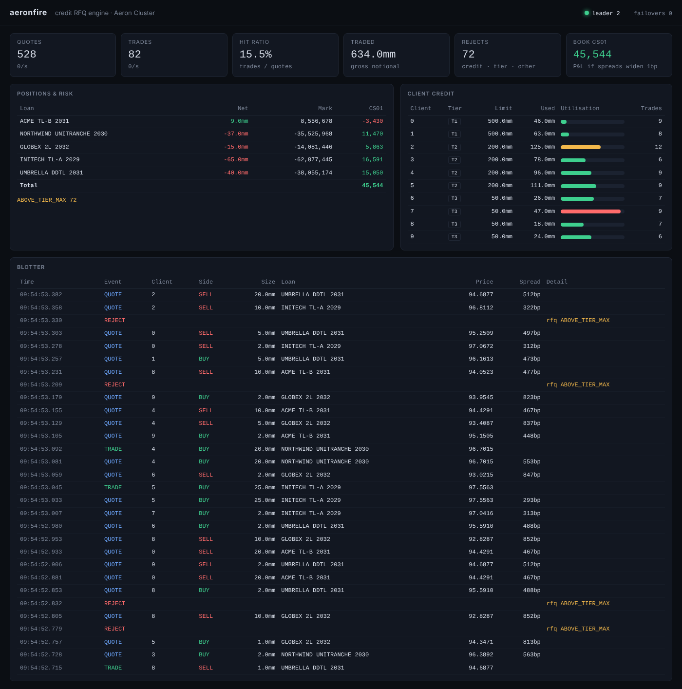

# aeronfire

A credit RFQ and pricing engine running as a replicated state machine on [Aeron Cluster](https://github.com/aeron-io/aeron).
A small, honest model of the pieces a dealer needs on a credit RFQ venue: a FIX gateway, firm quotes,
pre-trade credit and client tiering, execution, positions and spread risk, with failover that loses nothing.

Java 25 · Aeron 1.53 · Artio (FIX) · SBE · Agrona · HdrHistogram · Gradle 9

## What it does

```
 venue sim ──FIX R──▶ ┌──────────┐ ─RfqRequest─▶ ┌──────── Aeron Cluster (3 members, Raft) ────────┐
 (Tradeweb- ◀─FIX S── │   FIX    │ ◀───Quote──── │ sequenced log ─▶ RfqClusteredService (×3)        │
  style)    ─FIX AJ─▶ │ gateway  │ ─QuoteAccept─▶ │  credit · tiers · pricer · quotes · positions    │
            ◀─FIX 8── │ (Artio)  │ ◀─Trade/Reject │  snapshot/replay                                 │
            ◀─FIX AG─ └──────────┘                └──────────────────────────────────────────────────┘
```

1. The **venue simulator** plays a Tradeweb-style RFQ venue over FIX 4.4: clients (accounts 0–9, mixed
   tiers) ask for prices on five illustrative private-credit loans, and several dealers compete.
2. The **FIX gateway** (Artio acceptor) turns each QuoteRequest into a cluster RFQ.
3. The **clustered service** checks **credit and tier**, then prices: base spread over a benchmark,
   half bid/offer, size widening, **inventory skew** and a **tier adjustment**. Price is PV per 100.
4. It returns a **firm quote** whose time-to-live depends on the client's tier.
5. The venue invents competing dealers' prices and lifts or hits us only if we're best. On accept the
   service re-checks the quote and credit, books the **trade**, updates **positions** and **utilisation**.
6. Rejects go back as FIX QuoteRequestReject (tier, credit, instrument) or a rejected ExecutionReport.
7. **Snapshots** carry counters, positions, live quotes and credit lines, so a restarted member
   rejoins from a snapshot plus the log tail.

### Blotter: web and terminal



A monitor process subscribes to the cluster's **drop copy**: every quote, trade, reject and credit change
is copied to subscribed sessions with one non-blocking offer each, so a slow UI can never stall the log.
On subscribe the service sends a **state dump** (positions, credit lines), so a monitor that joins late
or misses copies resyncs. The monitor's cluster session survives failover: the header shows the new
leader and term, and the counts carry on.

- **Web:** JDK `HttpServer` plus Server-Sent Events, one static page, no framework. Virtual threads
  serve one blocking writer per browser tab.
- **Terminal:** ANSI redraw, no dependencies, works over ssh.

Shows flow (quotes, trades, hit ratio, rejects by reason), positions with mark and CS01 (P&L if spreads
widen 1bp), per-client credit utilisation, the live blotter, and cluster leader, term and failovers.

### Credit and tiering

| Tier | Spread adj. | Max ticket | Quote TTL | Demo clients | Demo limit |
|---|---|---|---|---|---|
| 1 | −5bp | 50mm | 3s | 0–1 | 500mm |
| 2 | 0bp | 25mm | 2s | 2–5 | 200mm |
| 3 | +10bp | 10mm | 1s | 6–9 | 50mm |

Utilisation is gross traded notional. It's checked on the RFQ (don't quote what the client can't trade)
and again on accept (other trades may have used the headroom since). `CreditUpdate` sets a line at
runtime; `CreditReset` is the start-of-day reset. Credit lives in the cluster, so two gateways can never
spend the same headroom.

### Verified

Run locally (3 members, gateway and venue on one 2-core box):

- 1,000 FIX RFQs → 837 quotes, 163 rejects (124 above tier max, 39 credit), 120 trades, nothing lost.
- 7,000 RFQ/trade round trips on the raw cluster client with no rejects (credit reset between phases).
- Leader killed between runs: a new leader is elected and trading continues.
- Blotter through a leader kill: stays connected, shows leader 0 → 1 in term 1, keeps counting.

Latency numbers from that box aren't meaningful (six JVMs sharing two cores); use
`scripts/bench-local.sh` on isolated cores for those.

### Control plane and entitlements

`control` (admin page :8090, MBeans under `aeronfire:type=*`, Jolokia :8778) is the only way to change
credit, inventory, RTS 6 controls, entitlements or eligibility. It holds the control credential
(`CONTROL_SECRET`) the cluster's authenticator checks; users log in with basic auth (demo password = user name,
override with `CONTROL_USERS=name:pw,...`) and every command carries that user's id into the cluster.

Entitlements are per user: permission bits (credit, inventory, position adjust, algo, kill switch,
entitlements, approve, hospital, replay, refdata, view), client and instrument scope, and personal limits
(max credit line, max position adjustment, max inventory limit). Anything over a limit, and every
entitlement grant, kill-switch release or de-listing, becomes a pending change that a second user with
`APPROVE` must approve; nobody approves their own. All of it is journalled with the acting user.

### Reference data

`refdata` (:8095) is the golden copy: in-house client/KYC master (simulated), plus open data. `REFDATA_MODE=live`
reads GLEIF (LEIs), FCA FIRDS (instruments) and the UK Sanctions List; `snapshot` (default) uses checked-in
extracts and also works offline. Each live source falls back to its snapshot on failure. Clients are
name-screened against the sanctions list: a potential match blocks the client until compliance discounts it
(an un-sanction is itself a four-eyes change in the cluster). Overrides need a reason and are audited.
The snapshot simulates a list update 45 seconds after start (client 8 becomes a match) and has client 6 with
overdue KYC, client 7 with a lapsed LEI, client 9 with no LEI and client 5 with no SSI. No real firm is
flagged; the sanctioned names in the snapshot are real designations that no demo client is meant to be.

### Post-trade

`posttrade` (:8096) pulls the cluster's guaranteed event feed by sequence number, checkpoints, and for every
trade: books it (settlement date, accrued interest, consideration), sends a DVP/RVP instruction to a clearer
simulator, builds a UK MiFIR RTS 22 transaction report for an ARM simulator, and publishes off-venue
trades through an APA simulator. Venue trades carry the venue's TVTIC (FIX `TrdMatchID`).

Failures go to the **hospital** with reasons: missing LEI or SSI, checksum failures, instrument not admitted
to the venue, ARM NACKs. Users with the `HOSPITAL` permission patch a report field (reason required) and
resubmit; booking problems are fixed in reference data and resubmitted. `REPLAY` re-runs reporting for a
sequence range (the ARM treats identical resends as duplicates) and processes trades it never saw.

Record keeping (MiFIR Art. 25 / RTS 25 spirit): an append-only, SHA-256 hash-chained log of every capture,
booking, report, ack/nack, repair, resubmit and replay with user and 5-year retention date. `/api/verify`
detects tampering; state is rebuilt from the log on restart. This is tamper-evident, not WORM: copy to
immutable storage in production.

Regulatory simplifications: UK regime (the FCA's bond transparency rules replaced RTS 2 on 1 December 2025);
the APA applies Category 1/2 and a single size threshold rather than the four size groups; no holiday
calendar; no short-selling indicator (not applicable to corporate bonds). RTS 6 is covered by the kill
switch, price collar and per-client throttle in the control plane.

## Design decisions

| Decision | Why |
|---|---|
| Replicated state machine (Aeron Cluster) | One sequenced log gives total order, determinism and failover without a database on the hot path. Same model as the Island/INET-style sequencer designs, with Raft for leader election. |
| Determinism rules | Cluster time only, never the wall clock. Ids from counters. No hash-ordered iteration. Java floating point has been strict since 17, so the pricer gives bit-identical results on every member. |
| SBE everywhere | Fixed-layout, zero-copy codecs for ingress, egress and snapshots. Schema versioned from day one. |
| No allocation on the hot path | Preallocated codecs and buffers; quotes and positions in primitive arrays (structure of arrays), sized up front. |
| Raw enum decoding on ingress | Decoding an unknown enum value throws; an exception in the service would stall the log. Validate the raw value instead. |
| Snapshot as many small messages | Each record stays well under the snapshot publication's max message length, however many quotes are live. An end marker confirms a complete load. |
| Quote ownership check | Only the session that received a quote can accept it, and only for the same RFQ. |
| Rejects name what they reject | Each reject carries the rejected template id, so the gateway knows whether an id is an RFQ or a quote. |
| Artio for FIX | Aeron-native FIX engine: the gateway's FIX journal and the cluster share one transport and tooling. |
| Gateway owns id mapping | One cluster session carries every venue's flow; the gateway maps FIX QuoteReqID/QuoteID to cluster ids. |

## Run it

### Docker (any machine, including a Mac)

```bash
docker compose up -d --build          # 3 members, FIX gateway (:9880), web blotter (http://localhost:8080)
docker compose run --rm venue         # Tradeweb-style venue over FIX, prints flow stats every 5s
docker compose run --rm tui           # terminal blotter
docker compose run --rm client        # raw cluster load test, prints latency percentiles
docker compose kill node0             # kill a member, run again: a new leader serves it
docker compose down
```

Any FIX 4.4 initiator can connect as `SenderCompID=TWSIM`, `TargetCompID=AERONFIRE`; the dictionary is
`src/main/resources/fix/aeronfire-fix44.xml`.

### Bare metal (latency numbers)

```bash
./scripts/bench-local.sh
```

Pins each member and the client to cores with `taskset`. For clean p99.9, boot with isolated cores
(`isolcpus`, `nohz_full`, `rcu_nocbs`) and point `NODE_CPUS` / `CLIENT_CPUS` at them. On macOS it
runs unpinned: fine for a functional check, not for publishing numbers.

### GCP (cheap, cost-controlled)

```bash
PROJECT=my-project ./deploy/gcp/up.sh                        # Spot e2-standard-4 in europe-west1
PROJECT=my-project BILLING_ACCOUNT=XXXXXX-XXXXXX-XXXXXX ./deploy/gcp/up.sh   # plus a budget alert
PROJECT=my-project ./deploy/gcp/down.sh
```

Spot pricing, a nightly stop schedule (22:00 London) and an optional budget alert. Defaults to
`europe-west1`; set `REGION=europe-west4` for the fallback.

### Risk as of a past point

The cluster records its snapshots in the Aeron Archive. `RiskAsOf` replays the latest service snapshot
(stream 106) from a member's archive, reads the positions and the event journal inside it, rolls positions
back to any journal sequence or time, and revalues with the pricer: mark, CS01, DV01 and an optional
parallel spread shock. It never touches the running cluster.

```bash
# take a snapshot on the leader (control plane: takeSnapshot, or Aeron's ClusterTool)
ASOF_SEQ=150 SHOCK_BPS=25 ./gradlew runRiskAsOf          # or ASOF_TIME=2026-10-23T09:30:00Z
```

`ARCHIVE_NODE` picks the member, `REPLAY_ENDPOINT` is where the replay is delivered. The reach back is the
journal carried in the snapshot (the most recent events); older points need an earlier snapshot.

### Requirements

JDK 25 and Gradle (via the wrapper). The build passes the flags Aeron/Agrona need on recent JDKs:
`--add-opens` for internal packages and `--sun-misc-unsafe-memory-access=allow`.

## Current-practice notes

- **`sun.misc.Unsafe` memory access is deprecated for removal** ([JDK-8331670](https://bugs.openjdk.org/browse/JDK-8331670)).
  Agrona still relies on it, hence the explicit `allow`. Watch Agrona's move towards the FFM API.
- **Generational ZGC** is the default ZGC mode on current JDKs. Compare it with tuned G1 for tail latency
  (`-XX:+UseZGC` is set by default here).
- **Virtual threads** suit I/O at the edges (gateways, admin, reporting), never the sequenced hot path.
- **Aeron** now lives under the `aeron-io` GitHub org. Dependabot groups Aeron, Agrona and SBE bumps so
  they stay in step.

## Roadmap

- [x] Pre-trade credit checks and client tiering.
- [x] Artio FIX gateway and Tradeweb-style venue simulator.
- [x] Web blotter and terminal UI: flow, positions, CS01, credit usage, cluster health.
- [x] Credit and inventory admin, RTS 6 controls, entitlements with four-eyes (control plane, MBeans, Jolokia).
- [x] Reference data: GLEIF, FIRDS and UK sanctions providers, screening, golden copy with audit.
- [x] Post-trade: booking, clearing instructions, MiFIR reporting, APA, hospital, replay, record keeping.
- [x] Post-trade page (http://localhost:8096) and `aeronfire:type=PostTrade` MBean (Jolokia :8779).
- [x] Failover test (`./gradlew failoverTest`, in CI): three member JVMs, leader SIGKILLed with an accept in flight, journal checked for lost, duplicated or gapped trades.
- [x] Gateway: survives a leader change (polls egress while offering, reconnects if the session closes), sweeps stale RFQs (timeout reject, accept resend, UNKNOWN_OUTCOME report), pools per-RFQ state. Verified by killing the leader mid-run: 102 in-flight RFQs got a TIMEOUT reject, trading resumed on the new leader.
- [x] Idempotent RFQ and accept: a resent RFQ id gets its existing quote back, a resent accept for a filled quote replays the original Trade (no second execution). The gateway resends both after a failover; verified: 100 in-flight RFQs resent, 0 timeouts.
- [x] Quote expiry via cluster timers (one per quote, QuoteExpired egress, state released on every member; tested after a leader kill).
- [x] Aeron Archive replay to rebuild valuations and CS01 as of a past log position (`RiskAsOf`, see below).
- [x] Risk egress: the cluster computes CS01 and DV01 (and mark) after every trade and position adjustment and pushes `RiskUpdate` to monitors, with book totals; the blotter shows them. One bond per issuer here, so by-issuer equals by-instrument; with this single-curve pricer DV01 equals CS01 numerically.
- [ ] Latency report: HdrHistogram per hop, ZGC vs G1, bare metal vs cloud.
- [ ] JMH benchmarks for the pricer and codecs.
